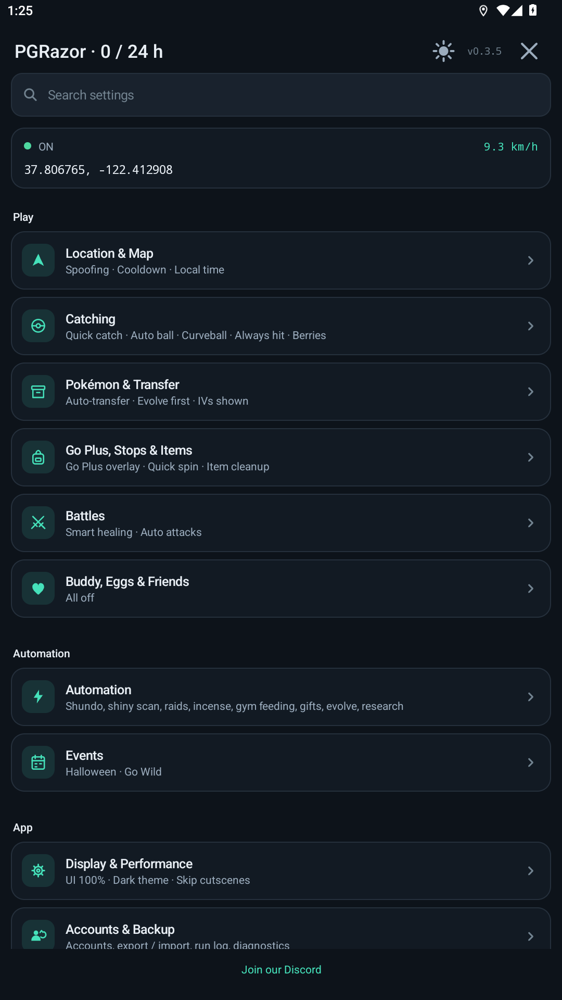

<p align="center"></p>
<h1 align="center">PGS — Pokémon GO Spoofers</h1>
<p align="center">A compact Android interface for location controls and Pokémon GO automation.</p>

PGS, based on PGRazor, adds an in-game menu, an independent joystick, encounter controls, and optional automation to Pokémon GO. Settings persist across restarts, with light and dark themes.

## PGS community integration

PGS preserves the complete PGRazor source tree and its MIT/third-party notices. This fork starts from PGRazor **v0.3.8**, commit `1106592aa045759f55f594ff6968f783ff636fe9`, for Pokémon GO **0.439.0 / 2026111602**. Internal packages, saved-setting keys and the original interface identity remain compatible with that base.

The current candidate adds the joystick direction lock, a direct gift shortcut, configurable LivePokeMap refresh, populated wild-encounter IVs for VGP+, owned-IV refresh/layer fixes, real-GPS readiness, buddy timeout recovery and the Silver Pinap preference migration. Android packaging also works on Linux with the pinned toolchain.

- Hold the joystick centre for **1.5 seconds**, drag and release to lock direction; hold the padlock for **0.5 seconds** to stop. Leaving the map or losing the camera releases it.
- Open **Quick Menu → Send & Open Gifts** for the existing batch dialog; press Start there when ready.
- In **Shundo Sniper**, choose **LivePokeMap refresh**. The default is five minutes; server limits can require a longer wait. The feed's **Global** view refreshes manually.
- See [the PGS integration review](docs/PGS_COMMUNITY_REVIEW.md) for source attribution, what was already present, remaining proposals and validation limits.

PGS candidate artifacts are produced in [this repository's Actions](https://github.com/LucianoToscano/PGS/actions). The upstream release links below describe the original PGRazor distribution. Compilation and automated fixtures do not establish Android installation or gameplay results; those observations are recorded separately.

The settings panel is grouped into Play, Automation and App cards, with an instant search field at the top. Search matches names, descriptions, categories and common synonyms (for example "fake gps" or "light mode"), and tapping a result opens the page, expands any collapsed section, and scrolls straight to that row.

## PGS interface languages

Open **Settings → Display & Performance → Language → PGS language**, choose a language, then fully close and reopen the game. The choices are **System, Deutsch, English, Español, Français, Português, Русский, Italiano, 繁體中文, Nederlands, ภาษาไทย and 한국어**. The selected language is shared by all accounts and included in explicit settings backups. The interface keeps its current language until the process restarts.

Translations are bundled offline. Search accepts both the selected language and the original English setting names. System follows the device language, using English if it is unsupported; Portuguese uses the Brazilian catalog and Chinese uses the Traditional Chinese catalog. This preference affects PGS menus, controls and messages. Pokémon names, user data, external service content and technical runtime diagnostics keep their original values; Pokémon GO's own language remains independent.

See [the language guide and translation workflow](docs/PGS_LANGUAGES.md) for the complete language list, backup behavior, validation and translation maintenance.

<p align="center"></p>

## Features and guides

The feature list and how-to guides live on the website, so there is one place to keep them current:

- **[PGS website](https://lucianotoscano.github.io/PGS/)**: overview, screenshots, and the cooldown chart.
- **[Feature guides](https://lucianotoscano.github.io/PGS/?guide=all)**: where each feature is in the app and how to use it.
- **[Changelog](CHANGELOG.md)** and [PGS releases](https://github.com/LucianoToscano/PGS/releases): PGS-only version history.

## Install PGS (Android, non-root)

**PGS version line:** v0.0.1 is the first public PGS version being prepared. The original PGRazor 0.3.8 base and the game 0.439.0 are separate version numbers. The previous v0.3.8-pgs.3 APK remains the last verified candidate until the new full release succeeds.


The latest **PGS** candidate verified by GitHub Actions is **v0.3.8-pgs.3**, based on **Pokémon GO 0.439.0** for ARM64. It is a complete APK, not the small source/preview package. **Installation, login and gameplay on a real device have not yet been confirmed.**

1. Open the [PGS v0.3.8-pgs.3 successful build](https://github.com/LucianoToscano/PGS/actions/runs/45963966748). Under **Artifacts**, download **PGS-v0.3.8-pgs.3** (GitHub sign-in may be required).
2. Extract the archive and use **PGS.apk**. Do not attempt to install the artifact ZIP, the source-tools bundle or a ~2 MB preview.
3. Verify the `PGS.apk` SHA-256 checksum: `1e42c50f84afe5edf9570dfa808ba5e4be99b64d3ae28199b7316981c7414d4c`. The artifact also contains `SHA256SUMS.txt` and `PGS.json`.
4. Install on an ARM64 device and check launch and login. Report the exact Android error if installation fails; a successful GitHub build is **not** a successful device installation.

The installer filename is `PGS.apk`, but the **installed app name remains Pokémon GO** and its package remains **`com.nianticlabs.pokemongo`**. The permanent PGS signing certificate is documented in [PGS update policy](docs/PGS_UPDATE_POLICY.md). After the initial installation, future updates must keep this package, certificate and increasing `versionCode`; they should not require removing the installed PGS or its saved data. Physical in-place update testing remains pending.

**Availability:** this specific GitHub Actions artifact is retained for seven days and is scheduled to expire on **December 4, 2026**. A successful CI/source-tools artifact is not an alternative game installer. No permanent PGS GitHub Release has been published yet.

**Do not confuse PGS with PGRazor.** The [upstream PGRazor releases](https://github.com/jpitty03/PGRazor/releases) and [upstream Root guide](docs/ROOTED.md) document the original, separate project; their APKs and signing identities are **not** PGS updates. This PGS download does not modify PGBR, PGSharp or PGRazor. A dedicated, protected full-release workflow is still required before a future PGS version can be published.

## Good to know

These are experimental client modifications. Server outcomes are not guaranteed, the cooldown timer is a local estimate, and nothing here prevents account action by the game's publisher.

## Community

Join the [PGS Discord](https://discord.gg/SdwU4VnfW), also linked from the settings footer. PGS acknowledges the independent upstream PGRazor project and its contributors.

## Build and contribute

- [Build, signing, release CI, and installation](docs/BUILDING.md)
- [Architecture and compatibility](docs/ARCHITECTURE.md)
- [PGRazor Root](docs/ROOTED.md)
- [Native migration verification and history](docs/NATIVE_MIGRATION.md)
- [Maintainability review and refactoring priorities](docs/MAINTAINABILITY.md)
- [Contributing and checks](CONTRIBUTING.md)
- [Third-party notices](THIRD_PARTY.md)

```powershell
python -B tools/check.py
```

Source CI runs device-free checks and compiles both the Android controls and the Root installer. Its downloadable artifact contains source and tools only, not a playable APK. The legacy **Android release (non-root and rooted)** workflow is intentionally blocked for PGS; only a dedicated PGS workflow may prepare a new signed game APK. Signing keys, original build inputs, and investigation logs are kept out of Git.

## Repository layout

```text
.github/workflows/    Source CI, release, and website workflows
docs/                 Build, architecture, and release notes
pgrazor/src/          Android UI and control bridge
pgrazor/native/       Compiled gameplay runtime and native tests
pgrazor/art/          Compiled Android runtime bridges
pgrazor/zygisk/       PGRazor Root loader
pgrazor/root-installer/  PGRazor Root installer app
pgrazor/test/         Regression tests
pgrazor/vendor/       Pinned dependencies, provenance, and licenses
tools/                Checks, source packaging, release CI setup
website/              React site and feature guides, deployed to GitHub Pages
```

## License

Original PGRazor source is available under the [MIT License](LICENSE). Third-party components retain their own licenses. Pokémon GO and its assets are not covered by this license. PGRazor is an independent project and is not affiliated with the game publisher.
